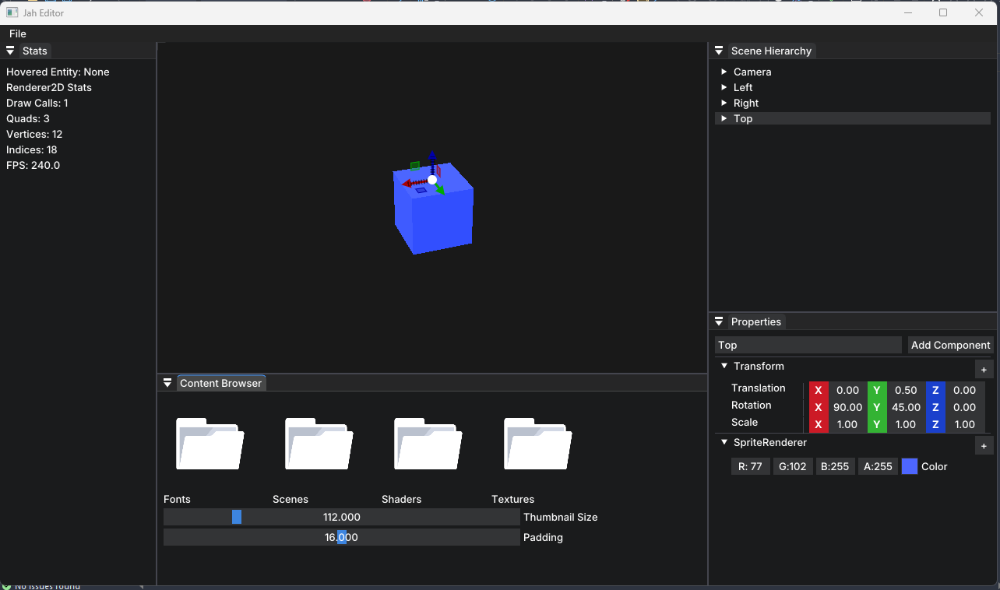

# Jah Engine



Jah Engine is a C++23 game engine inspired by [Hazel](https://github.com/TheCherno/Hazel).  
It provides a modern, lightweight framework for building 2D games with OpenGL.

---

## Features

### Current Features
- **2D Renderer**: Built with OpenGL
- **Scene System**: Play and Stop Button, Entities, Components, Serialization, Scene Hierarchy Panel, and Content Browser Panel
- **Mouse Picking**: Using framebuffer attachments for entity selection
- **Texture and asset management**
- **Input system**: Keyboard and mouse handling
- 2D physics system
- Circle rendering
- C# scripting support
- **Editor support**: Custom ImGui-based content browser and UI
- **Runtime support**: Dist configuration to ship games

### Coming Soon
- Sound Components
- Saving/Loading Textures
- Launcher
- Project System

---

## Getting Started

### Prerequisites
- Windows with the MSVC compiler (Visual Studio 2026 or Build Tools 2026)
- CMake 3.28+ and Ninja
- OpenGL 4.5+
- All other dependencies are included in the repository or as submodules

### Build
From an **x64 Native Tools Command Prompt for VS 2026**:

```bash
git clone --recurse-submodules https://github.com/JordanDia/Jah.git
cd Jah
cmake --preset debug
cmake --build --preset debug
```

The presets are `debug`, `release` and `dist`. Executables are written to `build/<preset>/bin/`.
Run Jah-Editor with `Jah-Editor/` as the working directory.

In VS Code, open the folder with the CMake Tools and C/C++ extensions installed, select a preset, then build with F7 and debug with F5.
